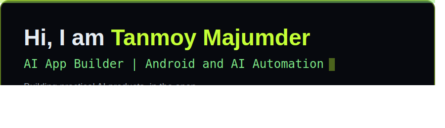

# ReadmeRocket

**One small config in, a full animated GitHub profile out.**

Give it as little as a name and a GitHub username, and ReadmeRocket
builds your whole GitHub profile: an animated hero banner, featured
project cards, a skills panel, a numbers panel with animated bars,
a connect panel, and the README.md that ties them together. Panels
with no data are simply left out, so a two-line config already
produces a clean, complete profile. No design work, no markdown
wrestling, no accounts, no API keys. Fully offline.



## Make it yours

The download starts with a neutral sample person (Alex Carter),
not with anyone's real data. Making your own profile takes a
minute:

1. Open the app and press **Start blank** (or just type over the
   sample; every field is editable).
2. Type your name and GitHub username. That alone is enough.
3. Add your skills as a comma list, your numbers, your links, and
   your projects, one per line in the projects box, in this shape:
   `Name | link | stars | what it does`.
4. Press **GENERATE MY PROFILE**. Your pack replaces the sample.

Your real details live only in your own `rocket.json` on your own
computer. A worked example with real data (the author's own
profile) is kept in `examples/` so you can see a finished result.

## Quick start (Windows)

1. Install Python 3 from python.org (tick "Add to PATH").
2. Double-click **ReadmeRocket.bat**.
3. Fill the form, pick a theme, click **GENERATE MY PROFILE**.
4. Your pack appears in the `profile_pack` folder.

On macOS or Linux: `./readmerocket.sh`.

## Make it your GitHub profile

1. Create a GitHub repo named exactly like your username
   (for example `github.com/you/you`). GitHub treats that repo's
   README as your public profile.
2. Copy `profile_pack/README.md` and the `profile_pack/assets`
   folder into that repo and push.
3. Done. Your profile is live, with the animations running.

## Minimum data example

This tiny config is enough for a complete profile:

```json
{ "name": "Asha Rao", "username": "asharao" }
```

The hero uses your name, the role defaults sensibly, your GitHub
link is built from the username, and empty panels are skipped.
Add role, skills, numbers, projects and links only if you want
those panels to appear.

## Command line

```
python readmerocket.py --demo     writes a sample rocket.json
python readmerocket.py            builds profile_pack from rocket.json
python readmerocket.py --config my.json --out mypack --theme ocean
```

## Templates and customisation

**Templates (structure):**
- **Classic**: about, projects, skills, stats, connect.
- **Showcase**: projects first, skills in a 3-wide grid.
- **Compact**: a short hero and a tight section order.

**Colours:** three presets (**lime**, **ocean**, **amber**) or your
own exact colours: accent, second colour and background pickers in
the GUI (or a `colors` object in the config).

**Typography:** Modern (Segoe UI), Mono (Consolas), Serif (Georgia)
or Impact (Arial Black). Text wrapping adapts to the font, so wide
mono text never spills out of its card.

**Structure options:** hero alignment (left or centre), rounded or
sharp corners, the flowing divider on or off, the stat bars on or
off, and animations on or fully static.

CLI equivalents: `--template`, `--font`, `--theme`, `--no-animate`.

## How the animation works

The panels are SVG images with SMIL animations inside them, the
same technique hand-built animated profiles use. GitHub renders
SVG images in READMEs and plays the animations natively: the
tagline types itself in, project cards and skill chips slide in
one by one, the number bars grow, and the divider line pulses,
all with no JavaScript.

## Files

| File | What it is |
|---|---|
| `readmerocket.py` | The generator engine and CLI |
| `readmerocket_web.py` | The local web GUI |
| `ReadmeRocket.bat` / `readmerocket.sh` | One-click launchers |
| `rocket.json` | Your config (the GUI edits this) |
| `profile_pack/` | The generated profile (README.md + assets) |
| `examples/` | A real generated profile (the author's) plus its config |

## Tested

- Fresh-folder end to end: sample config written, pack generated.
- All 3 themes: 15 files checked, every SVG valid XML, correct
  name and theme colours in the output.
- Error paths: missing config, broken JSON and a non-object JSON
  all exit with one clean message, no traceback.
- Empty config generates a full default pack.
- Names with special characters (&, <, >, quotes) still produce
  valid SVGs, and a 38-character name auto-shrinks to fit its
  panel (screen-checked).
- GUI tested through the app itself: page loads, form submit
  writes the config and generates a pack whose hero shows the
  entered name, bad input returns a clean error, the preview
  serves the generated panels, and folder-escape requests are
  refused.
- Minimum-data runs verified: name plus username alone yields a
  clean 4-file pack with the GitHub link derived from the
  username, username alone falls back gracefully, and a missing
  role no longer misplaces the hero cursor (fixed and
  screen-checked).
- Anyone-can-edit verified: the shipped config and pack are a
  neutral sample, the form has Start blank and Load sample
  buttons, skills and projects edit right in the form, and the
  author's real config survives separately in `examples/`.
- Customisation matrix verified: all 3 templates (section order,
  hero height, skill grid width), custom colours in the output,
  all 4 fonts, centred hero, sharp corners, animations fully off
  (zero animation tags), divider off, and a full custom run
  through the GUI. A mono-font run exposed two text-fit bugs
  (centred tagline clipped, project text overflowing its card);
  both fixed with font-aware measuring and re-checked on screen.
- No em dashes or en dashes anywhere in the generated output.

## License

MIT. Free to use, share and modify.
